# 第一周：课程介绍与编码 Agent 基础

## 本章导读

大语言模型[^1]可以回答编程问题，也可以生成代码。随着模型与编辑器、终端和代码仓库结合，AI 已经从简单的问答工具逐渐发展为能够参与软件开发过程的编码 Agent[^2]。

本周是整门课程的先导课，主要认识编码 Agent 的基本概念，了解它与传统 IDE[^3] 自动补全、通用对话式 AI 的区别，并建立对后续课程的整体认识。

本章学习路线如下：

```text
了解课程内容
→ 认识 AI 辅助编程的发展
→ 理解什么是编码 Agent
→ 比较不同 AI 编程工具
→ 了解课程安排和实践环境
```

[^1]: 大语言模型是从大量文本和代码中学习语言规律、能够根据输入生成内容的模型。
[^2]: 编码 Agent 是能够读取项目、调用开发工具并围绕编程目标连续执行步骤的 AI 系统。
[^3]: IDE 是集成开发环境，把代码编辑、运行、调试等开发功能集中在一个应用中。

## 一、为什么要学习 AI 人机协作

虽然大语言模型使用自然语言与用户交互，用户可以直接提出“解释这段代码”“实现一个栈”“修复这个错误”等要求，即使用户不掌握专用命令语法也能完成编码。

但是，能够用 AI 编码，不等于能够高质量地与 AI 协作。同一个任务使用不同的描述方式、使用不同的工具和技巧，可能得到差异很大的结果。

例如：

```text
完成一个考勤管理程序。
```

这条要求没有说明使用什么语言、是否使用 GUI 、管理何种考勤、返回什么结果，也没有说明如何判断任务完成。

更清楚的表达是：

```text
使用 Python 完成一个考勤管理小程序，需要编写 UI 界面，输入根据 input-samples 文件夹中的表格格式，输出按照 output-samples 文件夹中的表格格式，最终程序需要打包为一个 exe 文件。注意，你需要在完成编写后实际地运行测试并且根据测试结果调整程序，直到所有测试通过。
```

第二条要求明确了语言、数据格式、输入和输出行为，模型更容易生成符合需要的结果。

在真实项目中，任务还会涉及项目结构、代码规范、测试、版本控制和工具权限。因此，使用编码 Agent 不只是“让 AI 写代码”，还需要学习如何描述任务、提供上下文、检查修改并验证结果。

## 二、AI 辅助编程的发展

### 1. 代码补全

早期 AI 编程工具主要提供代码补全。开发者输入一部分代码后，工具根据当前文件和光标附近的内容，预测下一行或下一段代码。

例如：

```python
def is_empty(self):
    return
```

工具可能补全为：

```python
def is_empty(self):
    return len(self.items) == 0
```

这种方式可以减少重复输入，但工作的主要控制仍由开发者完成。

### 2. 对话式代码助手

大语言模型进入聊天界面后，用户可以直接使用自然语言讨论代码。

常见任务包括：

- 解释代码；
- 生成函数；
- 分析报错；
- 比较不同算法；
- 生成测试样例；
- 改写或注释代码。

当用户只向对话式代码助手粘贴一个函数时，模型只能依据该函数和同一会话中的材料回答，无法据此确认整个项目的目录、配置和调用关系。部分产品可以连接文件或仓库，其可见范围应按该产品和当前会话分别确认。

### 3. 多文件编辑

当模型被集成到编辑器中后，它可以读取当前项目中的更多文件，并根据自然语言要求直接生成修改。

例如，用户可以要求：

```text
为 Stack 类增加 peek() 方法，并补充对应测试。
```

工具可以同时修改实现文件和测试文件。AI 的作用由生成孤立代码片段，扩展为参与项目修改。

### 4. 编码 Agent

编码 Agent 进一步获得了项目搜索、文件编辑、终端执行和测试等工具。它不仅生成代码，还可以围绕一个任务连续执行多个步骤。

典型过程如下：

```text
接收任务
→ 搜索项目
→ 阅读相关文件
→ 修改代码
→ 运行测试
→ 根据结果继续修正
→ 汇报修改和验证结果
```

这使 AI 从“回答编程问题的工具”逐渐发展为“参与完成开发任务的协作者”。

## 三、什么是编码 Agent

### 1. 基本定义

编码 Agent（Coding Agent）是面向软件开发任务的 AI Agent。它以大语言模型为基础，并通过上下文和工具与真实项目环境进行交互。

可以使用下面的表达理解编码 Agent：

```text
编码 Agent = 模型 + 上下文 + 工具 + 工作循环
```

- **模型**负责理解任务和生成方案；
- **上下文**包括用户要求、项目文件和工具结果；
- **工具**用于搜索、读取、编辑和运行；
- **工作循环**使 Agent 能够根据新结果继续调整。


图片来源：[OpenAI：Unrolling the Codex agent loop](https://openai.com/index/unrolling-the-codex-agent-loop/)（访问日期：2026-08-12）。该图解释 Codex 的具体工作循环；其他编码 Agent 的工具种类和终止条件应依据各自产品确认。

### 2. 编码 Agent 可以做什么

在获得相应权限后，编码 Agent 可以：

- 搜索项目文件；
- 阅读源代码、配置和文档；
- 修改一个或多个文件；
- 运行程序、构建命令和测试；
- 根据错误信息继续修复；
- 查看代码差异；
- 汇报完成的工作和验证结果。

不同工具拥有的能力并不完全相同：有的只生成回答，有的可以修改工作区文件，有的可以在远程环境中异步执行仓库任务。使用前应确认当前产品实际提供的工具和权限。

### 3. 空栈错误修复示例

假设用户提出：

```text
修复 Stack.pop() 在空栈时出现的错误，并补充测试。
```

对话式 AI 可能直接给出一段修改建议。编码 Agent 则可以：

1. 搜索 `Stack` 的实现位置；
2. 阅读现有 `pop()` 和异常处理方式；
3. 找到栈的测试文件；
4. 修改实现并增加空栈测试；
5. 运行测试；
6. 根据测试结果继续修正；
7. 展示最终修改。

编码 Agent 的特点不只是“生成代码”，而是能够围绕任务形成一个可检查的工作过程。

## 四、三种 AI 编程方式的区别

### 1. IDE 自动补全

IDE 自动补全主要关注当前输入位置。它根据附近代码预测开发者接下来可能需要的内容，适合补全变量、函数调用和小段逻辑。


图片来源：[Visual Studio Code：Inline suggestions from GitHub Copilot in VS Code](https://code.visualstudio.com/docs/editing/ai-powered-suggestions)（访问日期：2026-08-12）。图中灰色代码是 GitHub Copilot 在 VS Code 中的行内建议，用户按 Tab 接受后才会写入编辑器；其他 IDE 的显示位置和快捷键可能不同。

### 2. 通用对话式 AI

通用对话式 AI 主要根据用户提供的消息、代码和附件生成回答，适合概念解释、方案讨论和代码示例。


图片来源：[OpenAI Help Center：ChatGPT macOS app - Screenshot Tool](https://help.openai.com/en/articles/9295245)（访问日期：2026-08-12）。截图以 ChatGPT macOS 应用为例，显示用户通过对话框提交文字和附件；不同通用对话式 AI 的按钮、附件能力和可见上下文并不相同。

### 3. 编码 Agent

编码 Agent 面向真实项目任务，可以主动搜索项目、修改文件并运行工具，适合修复缺陷、增加功能和执行测试等工作。


图片来源：[OpenAI：Introducing Codex](https://openai.com/index/introducing-codex/)（访问日期：2026-08-12）。该界面展示的是 Codex 云端任务形态：用户选择仓库和分支后提交任务，并查看任务进展；本地 CLI、IDE 内嵌 Agent 和其他供应商产品的界面会不同。

### 4. 对比表

| 形态 | 主要输入 | 主要输出 | 典型任务 |
| --- | --- | --- | --- |
| IDE 自动补全 | 当前文件和光标附近代码 | 下一行或代码片段 | 补全循环、条件和函数调用 |
| 通用对话式 AI | 用户消息、代码和附件 | 文字说明或代码回答 | 解释概念、分析错误、生成示例 |
| 编码 Agent | 开发任务、项目上下文和工具结果 | 项目修改、测试结果和工作说明 | 修复缺陷、增加功能、修改多个文件 |

三种方式并不是相互排斥的。开发者可以在输入代码时使用自动补全，在学习和讨论时使用对话式 AI，在处理项目任务时使用编码 Agent。

## 五、主流编码 Agent 形态

### 1. AI IDE 与编辑器内嵌 Agent

AI IDE 或编辑器内嵌 Agent 将模型能力加入代码编辑环境。用户可以在查看代码的同时提出问题、生成修改并审查代码差异。


图片来源：[Visual Studio Code：Use the Chat view](https://code.visualstudio.com/docs/agents/run/chat-view)（访问日期：2026-08-12）。该图以 VS Code Chat View 为例，展示 Agent 会话与代码编辑器并列的形态；其他 AI IDE 或编辑器插件的面板位置、权限控件和审查方式可能不同。

需要在同一编辑器中查看代码、提出修改并审查差异时，可以选择这种形态。

### 2. CLI Agent

CLI[^4] 是 Command Line Interface 的缩写，即命令行界面。CLI Agent 在终端中运行，可以直接结合当前项目目录搜索文件、编辑代码和执行命令。


图片来源：[Anthropic：Enabling Claude Code to work more autonomously](https://www.anthropic.com/news/enabling-claude-code-to-work-more-autonomously)（访问日期：2026-08-12）。该图以 Claude Code 的终端界面为例；Codex CLI 等其他 CLI Agent 的命令、状态区和审批提示会不同。

示例：

```text
> 分析当前项目的队列测试为什么失败，只诊断，不修改文件。
```

需要在本地项目目录中直接运行搜索、构建和测试命令，并且用户能够审查终端操作时，可以选择 CLI Agent。

### 3. 本地独立客户端 Agent

本地独立客户端 Agent 通过专门的桌面应用连接本机项目，不要求用户一直停留在代码编辑器或终端中。用户选择项目目录后，可以在客户端中管理任务线程、查看 Agent 的执行过程，并审查文件差异和测试结果。


图片来源：[Wikimedia Commons：Codex page.png](https://commons.wikimedia.org/wiki/File:Codex_page.png)（截图作者：Esculenta，CC BY-SA 4.0；访问日期：2026-08-12）；产品行为依据 [OpenAI：Introducing the Codex app](https://openai.com/index/introducing-the-codex-app/) 与 [Anthropic：Claude Code Desktop](https://code.claude.com/docs/en/desktop)。该图以 Codex 桌面端的本地项目入口为例；Claude Code Desktop 等客户端的布局、会话隔离和权限设置可能不同。

需要在一个独立窗口中集中管理本地项目、任务线程和差异审查时，可以选择这种形态。Claude Code Desktop 和 Codex 桌面端也可能提供云端或远程能力，但那是具体产品的运行环境选项，不等于“独立客户端”这一界面形态本身。

### 4. 形态选择

| 使用场景 | 合适的形态 |
| --- | --- |
| 编写代码时获得即时建议 | IDE 自动补全 |
| 在编辑器中阅读和修改项目 | AI IDE 或编辑器内嵌 Agent |
| 在本地项目中运行命令和测试 | CLI Agent |
| 在独立窗口中管理本地项目和多个任务线程 | 本地独立客户端 Agent |

工具选择应根据任务、环境和权限决定，而不是只根据产品名称决定。

[^4]: CLI 是命令行界面，用户通过在终端输入命令来操作程序。

## 六、*当前常见的编码 Agent 产品（选读）

下面介绍当前市面上较常见且具有代表性的部分产品。它们不是完整榜单，也不表示能力排名。产品功能、模型、价格和可用地区可能继续变化，实际使用时应以各产品的最新官方页面为准。

### 1. Claude Code

Claude Code 是 Anthropic 面向软件开发的编码 Agent，可在终端、IDE、桌面应用和网页中使用。它能够读取代码库、修改文件、运行命令，并围绕功能开发、缺陷修复和测试等任务持续工作。

它的特点是同一套编码能力覆盖多种使用界面。喜欢终端的开发者可以直接在项目目录中使用 CLI；需要图形界面的用户可以在 Claude Desktop 的 Code 页面中管理多个会话、查看代码差异，并把聊天、终端、文件和应用预览放在同一工作区。不同界面的具体能力并不完全相同，不能把桌面端功能直接当作 CLI 功能。


图片来源：[Anthropic：Navigating the Claude desktop app](https://claude.com/resources/tutorials/navigating-the-claude-desktop-app)（访问日期：2026-08-15）。截图展示 Claude Desktop 的 Code 页面；终端版、IDE 版和网页版的布局不同。

### 2. Codex

Codex 是 OpenAI 的编码 Agent，可以通过桌面应用、CLI、IDE 扩展和云端环境处理软件开发任务。它能够读取和修改项目、运行命令与测试，并把实际文件变化和执行结果返回给用户审查。

Codex 桌面应用的特点是以项目和任务线程组织工作。用户可以让多个任务分别运行，在会话中查看修改、评论差异，并选择本地目录、隔离工作区或云端环境。CLI 更适合终端工作流，IDE 扩展更接近代码编辑位置，因此使用时应根据任务和界面选择，而不是只比较模型名称。


图片来源：[OpenAI：Codex](https://openai.com/codex/)（访问日期：2026-08-15）。截图展示 Codex 应用处理工程任务后的主要工作区域，用户可以阅读执行结果并进入 Review 查看文件变化；Codex CLI、IDE 扩展和云端任务界面不同。

### 3. TRAE

TRAE IDE 是面向软件开发者和工程团队的 AI 集成开发环境。它把项目浏览、代码编辑、代码建议和 Agent 任务放在同一工作区中，使用户可以在查看代码的同时向 Agent 提交开发要求。

TRAE IDE 当前提供 IDE Mode 和 SOLO Mode。IDE Mode 在传统代码编辑流程中加入 Agent 能力，适合用户一边编辑、一边让 Agent 协助；SOLO Mode 则让 Agent 更自主地理解上下文、规划步骤、调用工具并完成端到端开发任务。两种模式代表不同的协作程度，具体入口和可用能力可能随客户端版本更新。


图片来源：[TRAE 官方中文社区：TRAE IDE 软件使用指南](https://forum.trae.cn/t/topic/9361)（访问日期：2026-08-15）。截图展示 TRAE IDE 中的 Agent 工作区域；界面会随版本与所选模式变化。

### 4. GitHub Copilot

GitHub Copilot 最初以编辑器中的代码补全和对话功能为人熟知，目前已经包含 IDE Agent、CLI、云端编码 Agent 和独立 Copilot 应用等多种形态。IDE Agent 可以选择文件、提出修改并运行命令；云端 Agent 可以在 GitHub 仓库分支上工作，并把结果交给用户通过合并请求审查。

它的特点是与 GitHub 开发流程结合紧密。仓库、Issue、分支、代码差异、持续集成结果和合并请求可以成为同一工作流程的一部分。同时，“GitHub Copilot”并不是一个单一界面：编辑器补全、IDE Agent、云端 Agent、CLI 和桌面应用的权限与执行位置不同，介绍或使用时需要说明具体形态。


图片来源：VS Code 环境截图（2026-08-16）；产品形态说明依据 [GitHub Docs：GitHub Copilot features](https://docs.github.com/en/copilot/get-started/features)。截图展示 VS Code 中的 GitHub Copilot 功能引导和会话区域；Copilot 独立应用、云端 Agent 和 CLI 的界面不同。

### 5. WorkBuddy

WorkBuddy 是腾讯推出的全场景职场 AI Agent 桌面工作台，并不是只服务软件开发的专用编码 Agent。它同时覆盖日常办公、代码开发和设计创意；在代码开发模式中，官方文档列出的场景包括代码生成、代码审查、缺陷修复、重构、项目理解以及网站或应用开发。

它的特点是把代码任务与文档、表格、演示文稿、数据分析和本地文件处理放进同一任务工作台，并支持同时管理多个任务。对于学习编码 Agent，应重点观察其代码开发模式怎样读取授权文件、执行步骤和展示结果，不要把办公或设计能力当作所有编码 Agent 都具备的共同功能。

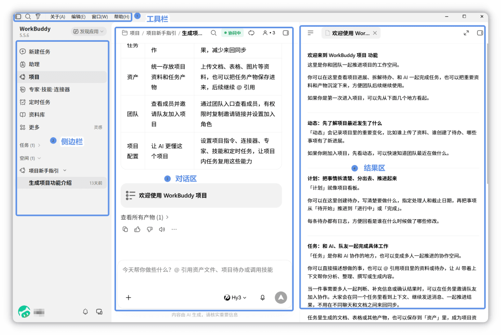

图片来源：[腾讯 WorkBuddy 文档：产品概览](https://www.workbuddy.cn/docs/workbuddy/Overview)（访问日期：2026-10-09）。截图展示 WorkBuddy 的任务工作台；代码开发只是其多个任务模式之一。

### 6. DeepSeek Harness

DeepSeek Harness（命令名 `dsh`）是 DeepSeek AI 开源的 Agent Harness[^5]，同时提供可直接使用的 Agent 界面和可扩展的运行框架。截至 2026 年 10 月 9 日，官方已提供 macOS（Apple 芯片）和 Windows（64 位）桌面端下载，也保留通过命令启动 Web UI 的方式；因此，认识这款产品时应同时关注桌面应用和开发者运行环境。

在编码场景中，它可以理解项目、修复问题、开发功能和运行测试。使用 Web UI 时，需要配置模型并添加、选中项目工作区，之后 Agent 才能读取和编辑工作区文件、运行命令、委派工作并维护计划；需要审批的操作按当前权限策略请求确认。桌面端和 Web UI 的入口、模型配置与授权方式应按各自界面确认，不能直接套用其他产品的规则。

它仍以“一切皆插件”为主要特点，基于 Cordis 架构将 Agent 能力组织成可以组合的插件。用户可以安装插件，也可以在“创造模式”中通过对话创建插件，扩展工具、技能和界面；开发者还可以查看执行轨迹，分析工具调用和任务执行过程。第一周只认识这些能力与产品形态，插件开发、权限控制和多 Agent 协作将在后续周次展开。

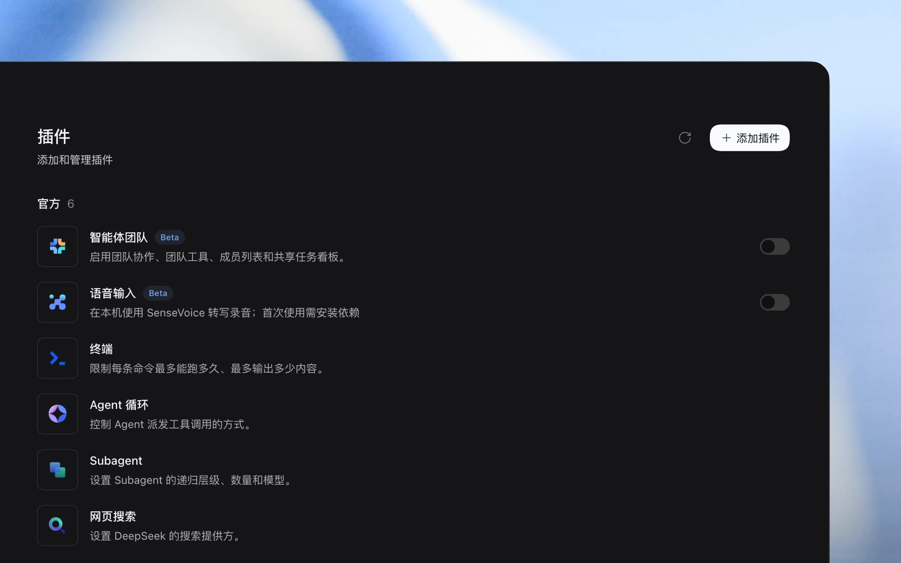

图片来源：[DeepSeek：DeepSeek Harness](https://www.deepseek.com/harness/)（访问日期：2026-10-09）。截图展示当前官网使用的插件管理界面；图中的智能体团队和语音输入带有 Beta 标记，实际插件列表与状态可能随版本变化。

需要注意，官网将当前产品标为“预览版”，开源仓库仍说明其处于 Developer Preview（开发者预览版），核心插件和基础 API[^6] 会持续迭代，并可能出现不兼容的变化。学习时应以所安装版本和当前官方文档为准，不把预览版界面、插件接口或功能列表当作长期稳定规则。

[^6]: API 是让不同程序按照约定互相发送请求和返回结果的接口。

### 7. 六款产品的主要区别

| 产品 | 主要形态与核心特点 |
| --- | --- |
| Claude Code | 提供 CLI、IDE、桌面和网页等界面，能够直接结合项目文件和命令工作。 |
| Codex | 提供桌面、CLI、IDE 和云端形态，以任务线程组织工作，可在本地、隔离工作区或云端执行。 |
| TRAE | 以 AI IDE 为主要形态，可在保留编辑器操作的 IDE Mode 与更自主执行任务的 SOLO Mode 之间切换。 |
| GitHub Copilot | 覆盖 IDE、CLI、云端和桌面应用，与 GitHub 仓库、Issue、分支、合并请求和持续集成紧密结合。 |
| WorkBuddy | 属于全场景桌面 Agent，代码开发与办公、设计和多种文件交付共用一个工作台。 |
| DeepSeek Harness | 提供桌面端、Web UI 和可插拔 Agent 运行框架，既可处理编码任务，也可通过插件扩展能力；当前仍为预览版。 |

这些产品都可以参与开发任务，但入口、可见上下文、工具、权限和结果交付方式不同。判断一款工具是否适合当前任务，应先确认它在所用界面中能访问什么、能执行什么、怎样请求授权，以及用户怎样审查最终修改。

[^5]: Harness 是把模型、工具、权限和执行循环组合起来，使 Agent 能在真实环境中持续工作的运行框架。

## 七、人与编码 Agent 的分工

编码 Agent 可以快速搜索、生成和修改代码，但它并不保证所有判断都正确。模型可能误解需求、遗漏项目规则，也可能生成不存在的 API。

在人机协作中，人和 Agent 具有不同职责。

| 人的主要职责 | Agent 擅长的工作 |
| --- | --- |
| 确定目标和需求 | 搜索和整理项目文件 |
| 设置任务范围和权限 | 生成代码与重复性内容 |
| 作出关键设计选择 | 按已有模式修改多个文件 |
| 审查修改和风险 | 运行测试并整理结果 |
| 验收结果并承担责任 | 根据明确反馈继续修正 |

想象你是领导，而 Agent 就是你的下属，你的职责就是告诉它做什么、检查它做得怎么样，并对最终结果负责。Agent 的职责就是帮助你执行、检查和整理。


## 八、怎样判断任务是否完成

代码能够生成，不代表功能已经完成。真实项目中的代码还需要运行和验证。

例如，Agent 声称“已经修复”，用户仍应检查：

- 修改了哪些文件；
- 修改是否符合任务范围；
- 是否运行了相关测试；
- 测试是否通过；
- 是否存在未验证的内容；
- 代码差异中是否有无关修改。

本课程使用下面的基本标准：

```text
任务完成 = 修改结果 + 运行证据 + 人工审查
```

后续课程将分别学习测试、Git、diff 和代码审查等方法。

## 九、课程目标与整体安排

### 1. 课程目标

完成本课程后，学习者应能够：

- 使用清楚的 Prompt 描述开发任务；
- 分析需求并拆分复杂任务；
- 为 Agent 提供必要的项目上下文；
- 使用 Agent 阅读和修改代码项目；
- 观察 Agent 的工具调用和执行过程；
- 使用测试和 Git 检查修改；
- 识别幻觉、误改和隐私等风险；
- 理解 MCP、Skill 和多 Agent 协作的基本概念。

### 2. 十二周课程安排

| 周次 | 主题 |
| --- | --- |
| 第一周 | 课程介绍与编码 Agent 基础 |
| 第二周 | 提示词工程 |
| 第三周 | 需求分析与任务拆解 |
| 第四周 | 上下文工程与 AGENTS.md |
| 第五周 | 代码阅读与项目理解 |
| 第六周 | Agent 工作流 |
| 第七周 | 工具调用 |
| 第八周 | 测试驱动的 Agent 开发 |
| 第九周 | 代码审查、Git 与质量控制 |
| 第十周 | 风险与边界 |
| 第十一周 | MCP 与 Skill |
| 第十二周 | 多 Agent 协作与代码重构 |

整门课程的学习主线是：

```text
表达任务
→ 提供上下文
→ 规划和执行
→ 使用工具验证
→ 审查结果并控制风险
```

## 十、课程项目与环境准备

### 1. 课程项目

本课程以数据结构项目作为实践载体。栈、队列、链表等数据结构具有清楚的接口和边界条件，便于观察 Agent 如何阅读项目、修改代码和补充测试。

课程项目仓库：[https://github.com/Lancelot252/yatds](https://github.com/Lancelot252/yatds)。

实验内容位于远程容器所拉取的仓库中，无需单独拉取。

### 2. 基础环境
本课程提供远程容器访问作为实验环境，学习者无需在本机安装 Python、Git 或其他工具。
远程容器位于 [https://ol.yatcc.arcsysu.cn/](https://ol.yatcc.arcsysu.cn/)，初始账号密码为你的学号。

登陆进入主界面之后，首先需要在**创建服务**中选择本课程容器并创建，之后在**我的服务**中即可看到容器并启动进入（具体操作指引位于主页面内）。

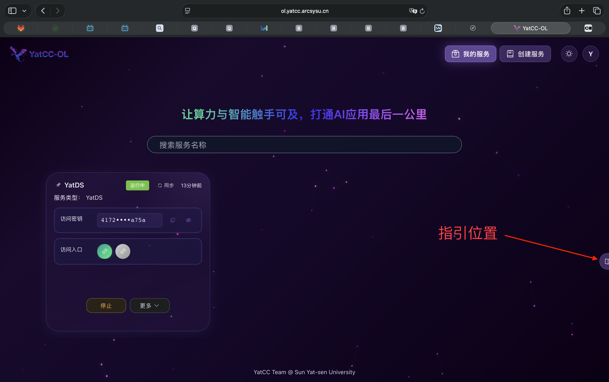

容器初次启动时，会出现长时间无法显示界面的情况，耐心等待和刷新即可(真的非常非常久哦)。

2000 years later……

进入容器后，页面与~~微软大战代码~~Microsoft VS Code 类似，熟悉 VS Code 的同学应该可以很快上手操作。

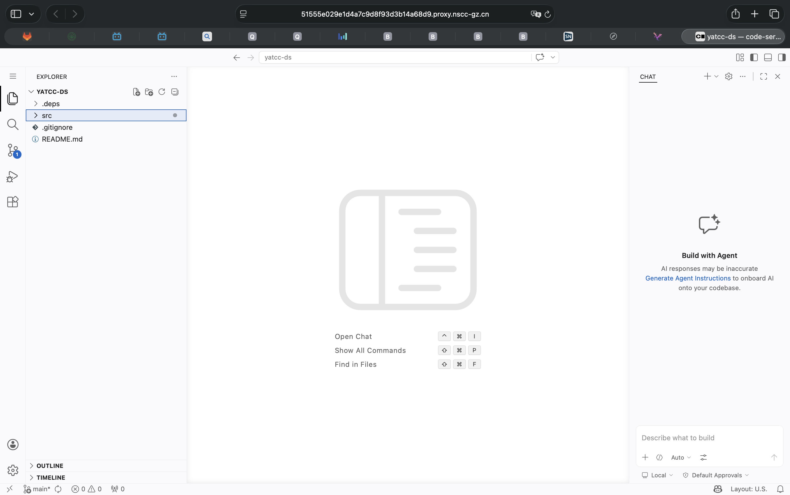

### 3. 配置课程使用的编码 Agent

课程容器已经安装 Claude Code 和 `cc-switch`。本节要做的不是重新安装 Claude Code，而是通过 `cc-switch` 把 Claude Code 连接到课程提供的 AIHub 服务。这里的地址、密钥和代理步骤只适用于本课程环境，不是 Claude Code 的通用官方配置方法。

#### 3.1 打开 `cc-switch`

在容器左上角打开主菜单，依次选择 **Terminal → New Terminal**，也可以直接使用终端快捷键。

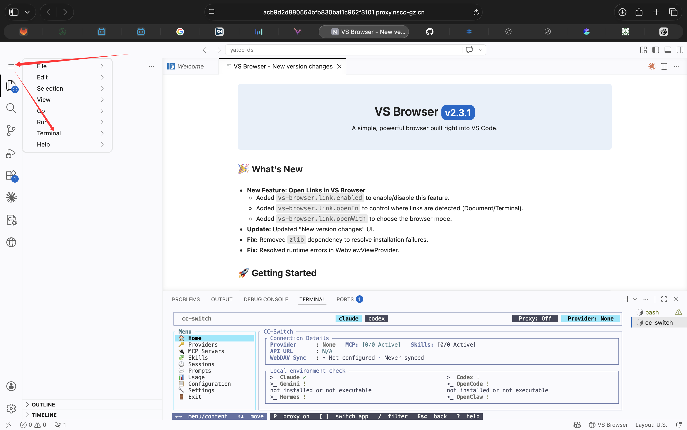

在终端中运行：

```bash
cc-switch
```

`cc-switch` 是课程环境用于切换模型服务配置的工具，不是 Claude Code 本身。进入界面后，先阅读窗口底部的按键提示：通常使用方向键移动，按 `Enter` 编辑或确认，按 `Esc` 返回。不同版本显示的按键可能略有不同，应以当前界面底部的提示为准。

#### 3.2 将界面切换为中文

如果界面当前为英文，移动到 **Settings**，选择 **Language**，按 `Enter` 后将语言改为 **中文**。

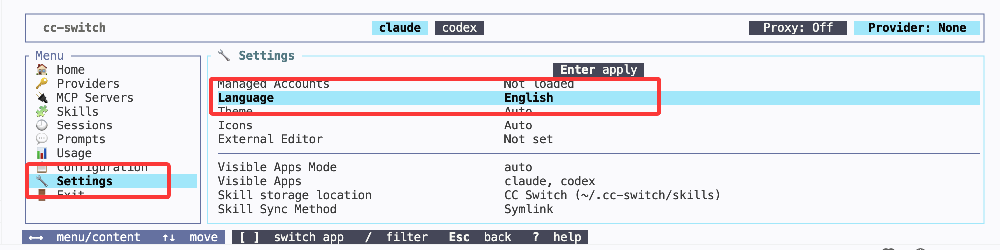

语言切换只改变 `cc-switch` 的显示文字，不会改变 Claude Code 的回答语言或模型。

#### 3.3 添加课程供应商

进入 **供应商** 页面。若列表中保留了当前不使用的 **Claude Official** 配置，先选中它，再按照底部提示按 `D` 删除；然后按 `A` 添加自定义供应商。课程配置填写如下：

| 字段 | 填写内容 |
| --- | --- |
| 模板 | `Custom` |
| 名称 | `Yatcc` |
| API 请求地址 | `https://aihub.arcsysu.cn/v1` |
| API Key | 教师单独分配给本人的密钥 |

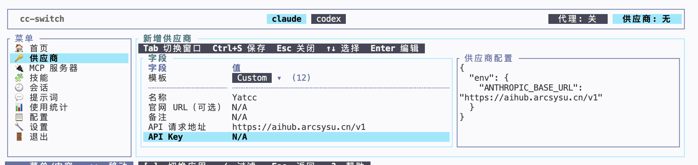

API Key 相当于访问模型服务的密码。输入时不要加引号或多余空格，也不要把密钥写进代码、提交到 Git、发到群聊，或截入公开图片。若怀疑密钥已经泄露，应停止使用并联系教师更换。

继续将 **API 格式** 设置为 **OpenAI Chat Completions（需开启代理）**。这里的“OpenAI Chat Completions”描述的是课程 AIHub 提供的请求格式，并不表示当前一定在使用 OpenAI 模型。`cc-switch` 需要通过本地代理把这种格式转换为 Claude Code 可以使用的格式，因此后面还必须开启代理。

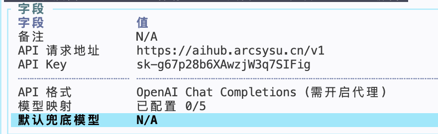

#### 3.4 设置模型映射并保存

选中 **模型映射**，按 `Enter` 进入设置。`cc-switch` 的 Claude 配置界面会列出 Haiku、Sonnet 和 Opus 等模型角色，课程环境需要把这些角色映射到 AIHub 中实际可用的模型名称。按 `Space` 可以尝试从服务获取当前模型列表；按 `Enter` 可以手动编辑选中的映射。

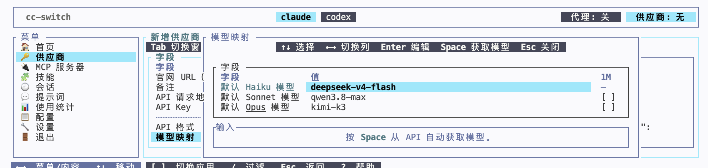

模型列表和可用额度可能调整，因此不要机械照抄截图中的模型名称。按教师当次公布的要求选择；如果没有指定，选择自己账号当前可用的模型，并确认至少为准备使用的角色设置了映射。完成后按界面顶部提示使用 `Ctrl+S` 保存，再按 `Esc` 返回。

#### 3.5 开启本地代理

回到 **首页**，按底部提示中的 `P` 开启代理。成功后，页面右上角应显示 **代理：开**，供应商应显示 **Yatcc**。

使用 **OpenAI Chat Completions** 格式时，代理必须保持运行。不要关闭当前 `cc-switch` 终端；如果容器重启、终端任务结束或右上角重新显示 **代理：关**，需要再次运行 `cc-switch` 并开启代理。

#### 3.6 打开 Claude Code 并验证连接

点击编辑器右上角的 Claude Code 菊花图标，打开 Claude Code 面板。

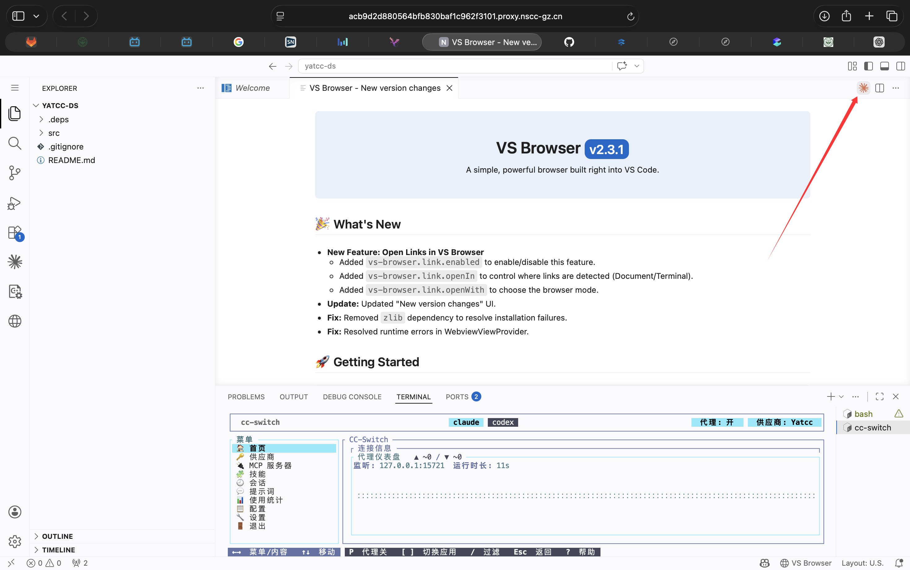

在输入框下方点击模型名称，确认当前模型来自刚才保存的映射。然后发送一条不会改动项目的验证消息：

```text
请只回答“连接成功”，不要修改文件，也不要运行命令。
```

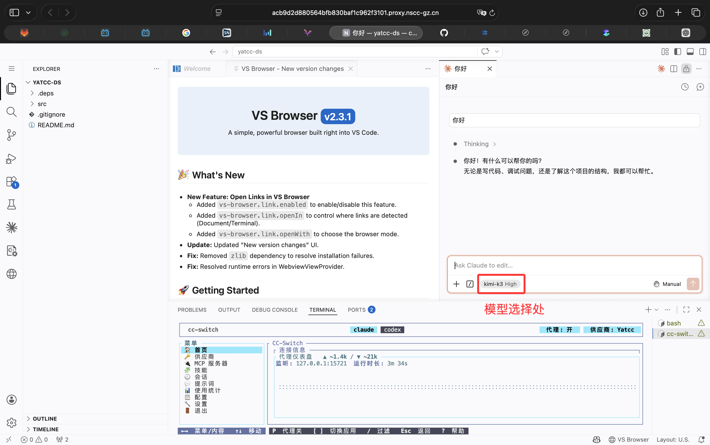

能够收到正常回复，并且界面没有出现认证失败、模型不存在或连接错误，才说明配置基本成功。若验证失败，依次检查：代理是否为“开”、当前供应商是否为 `Yatcc`、API 请求地址是否完整、API Key 是否输入正确，以及所选模型是否仍在可用列表中。

课程容器也提供 Claude Code 命令行版本。需要使用 CLI 时，新开一个终端并运行：

```bash
claude
```

图形扩展和 CLI 是 Claude Code 的两种使用界面。本课程当前先使用扩展完成入门操作；CLI 的完整命令与参数可查阅 [Anthropic：Claude Code CLI reference](https://code.claude.com/docs/en/cli-reference)。

### 4.实验容器使用须知

- 容器的使用时长为每人240h，超过时长后将无法继续使用。请合理安排实验时间，在完成每次实验后及时退出容器，避免占用时长。

- 容器重新启动会导致cc-switch的配置清空，因此建议每次修改后将配置导出保存，重新启动后直接导入即可，不需要再次从头配置。

#### 4.1 cc-switch 配置导出导入教程

`cc-switch` 可以把当前供应商、模型映射和其他设置导出为 SQL[^7] 配置备份。容器重新启动前，建议先把配置导出；之后可直接导入备份，不必重新逐项填写。

[^7]: SQL 配置备份是用数据库语句保存完整配置、供软件恢复使用的文件。

##### 第一步：进入导出配置

在 `cc-switch` 左侧菜单中选择 **配置**，再选择 **导出配置**，按 `Enter` 打开导出窗口。

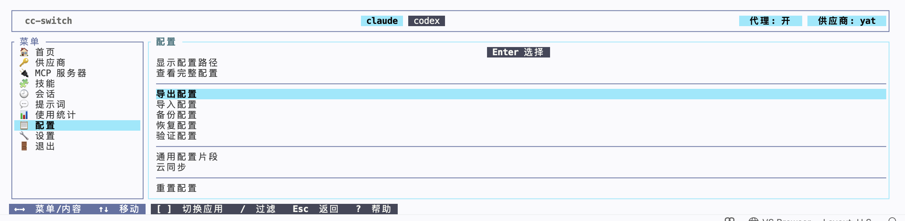

##### 第二步：确认导出路径

导出窗口会显示配置文件的保存路径。可以直接保留默认值 `./config-export.sql`，也可以输入其他路径。路径中的 `./` 表示启动 `cc-switch` 时所在的当前文件夹；确认后按 `Enter` 导出。

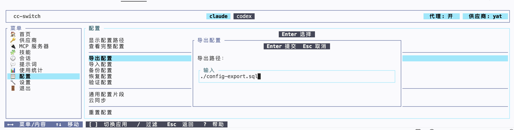

导出完成后，在左侧文件浏览器中确认出现 `config-export.sql`。如果没有看到，可以刷新文件列表，并检查导出时填写的路径。

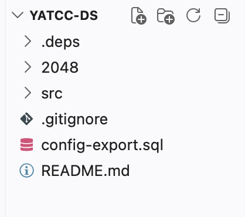

导出的 SQL 文件可能包含供应商配置和 API Key，作用类似配置密码文件。不要把它提交到 Git、上传到公开网盘或发送给其他人。需要跨容器保存时，应下载到自己的安全位置。

##### 第三步：导入配置

需要恢复时，先把此前导出的 `.sql` 文件放入当前容器。在 `cc-switch` 中选择 **配置 → 导入配置**，输入该文件的完整路径或相对于当前文件夹的路径，例如：

```text
./config-export.sql
```

按 `Enter` 确认导入。导入会覆盖当前 `cc-switch` 配置；如果当前容器中已有需要保留的新配置，应先另行导出备份。导入完成后，检查供应商、API 请求地址和模型映射是否正确。

##### 第四步：重新开启代理并验证

导入配置不会代替代理启动操作。返回 **首页**，按 `P` 重新开启代理，确认右上角显示 **代理：开** 且供应商为 **Yatcc**。最后回到 Claude Code，发送一条只读验证消息；能够正常收到回复且没有认证或模型错误，才说明恢复成功。

### 5.查看html版本实验内容的方法

在终端中打开 `src/Pages` 目录，运行：

```bash
python3 -m http.server 8000
```
之后在浏览器中访问 `https://<你的容器id（就是浏览器网址那里的一长串乱码一直到8443那里）>/proxy/8000/`，即可查看实验内容的 HTML 版本。

PS.之后实验中有关网络服务的内容都可以通过类似的方法来访问。

## 十一、常见错误认识

### 1. “会自然语言就一定会用好 Agent”

自然语言降低了使用门槛，但模糊任务仍会使 Agent 作出错误猜测。清楚表达和结果检查仍然重要。

### 2. “Agent 就是更强的自动补全”

自动补全关注下一行代码，Agent 关注如何通过多个步骤完成任务。

### 3. “代码生成出来就代表完成”

生成的代码只是候选结果。没有运行、测试和审查，就没有充分的完成证据。

### 4. “Agent 说得自信就一定正确”

回答语气不能证明事实。用户应依据项目文件、测试结果和代码差异进行判断。

### 5. “权限越多越方便”

权限越大，错误操作的影响也越大。Agent 应只获得完成当前任务所需的权限。

## 十二、本章总结

编码 Agent 是面向软件开发任务的 AI Agent。它将大语言模型与项目上下文、文件工具、终端和测试结合，可以在真实项目中搜索、修改、运行并根据结果继续工作。

IDE 自动补全主要生成局部代码，对话式 AI 主要生成回答，编码 Agent 则面向完整开发任务。不同工具各有适用场景，可以在实际开发中配合使用。

人与 Agent 的基本分工是：人负责目标、范围、授权、审查和最终责任，Agent 帮助搜索、生成、修改和验证。

本章核心可以概括为：

```text
编码 Agent = 模型 + 上下文 + 工具 + 工作循环

任务完成 = 修改结果 + 运行证据 + 人工审查
```

## 参考文献

1. OpenAI. [Introducing Codex](https://openai.com/index/introducing-codex/). 2025-05-16。访问日期：2026-07-23。
2. OpenAI. [Unrolling the Codex agent loop](https://openai.com/index/unrolling-the-codex-agent-loop/). 2026-01-23。访问日期：2026-07-23。
3. GitHub. [About GitHub Copilot cloud agent](https://docs.github.com/en/copilot/concepts/agents/cloud-agent/about-cloud-agent). GitHub Docs. 访问日期：2026-07-23。
4. Anthropic. [Claude Code overview](https://code.claude.com/docs/en/overview). Claude Code Documentation. 访问日期：2026-07-23。
5. Anthropic. [Navigating the Claude desktop app: Chat, Claude Cowork, Claude Code](https://claude.com/resources/tutorials/navigating-the-claude-desktop-app). 访问日期：2026-08-15。
6. OpenAI. [Introducing the Codex app](https://openai.com/index/introducing-the-codex-app/). 访问日期：2026-08-15。
7. TRAE. [TRAE IDE](https://www.trae.ai/ide/). 访问日期：2026-08-16。
8. GitHub. [GitHub Copilot features](https://docs.github.com/en/copilot/get-started/features). GitHub Docs. 访问日期：2026-08-15。
9. GitHub. [About the GitHub Copilot app](https://docs.github.com/en/copilot/concepts/agents/github-copilot-app). GitHub Docs. 访问日期：2026-08-15。
10. Tencent. [WorkBuddy 产品概览](https://www.workbuddy.cn/docs/workbuddy/Overview). 访问日期：2026-10-09。
11. DeepSeek AI. [DeepSeek Harness](https://www.deepseek.com/harness/)、[官方开源仓库 README](https://github.com/deepseek-ai/deepseek-harness#readme). 预览版。访问日期：2026-10-09。
12. DeepSeek AI. [使用 Web UI](https://deepseek-harness.github.io/deepseek-harness/guide/quickstart). 访问日期：2026-10-09。
13. Roo Code. [Installing Roo Code](https://roocodeinc.github.io/Roo-Code/getting-started/installing/). 访问日期：2026-08-15。
14. Roo Code. [Roo Code Documentation](https://roocodeinc.github.io/Roo-Code/). 访问日期：2026-08-15。
15. Anthropic. [Use Claude Code in VS Code](https://code.claude.com/docs/en/vs-code). Claude Code Documentation. 访问日期：2026-10-01。
16. Anthropic. [Claude Code CLI reference](https://code.claude.com/docs/en/cli-reference). Claude Code Documentation. 访问日期：2026-10-01。
17. CC Switch. [Add Provider](https://github.com/farion1231/cc-switch/blob/main/docs/user-manual/en/2-providers/2.1-add.md). GitHub. 访问日期：2026-10-01。
18. CC-Switch CLI. [README](https://github.com/SaladDay/cc-switch-cli/blob/main/README.md). GitHub. 访问日期：2026-10-01。
19. OpenAI. [Chat Completions API reference](https://developers.openai.com/api/reference/cli/resources/chat). OpenAI Developers. 访问日期：2026-10-01。
20. CC-Switch CLI. [Configuration import and export](https://github.com/SaladDay/cc-switch-cli/blob/main/README.md). GitHub. 访问日期：2026-10-10。
21. CC Switch. [配置文件说明与备份建议](https://github.com/farion1231/cc-switch/blob/main/docs/user-manual/zh/5-faq/5.1-config-files.md). GitHub. 访问日期：2026-10-10。
